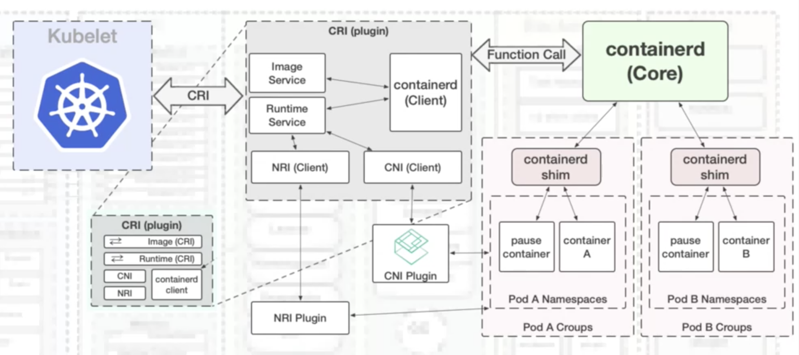
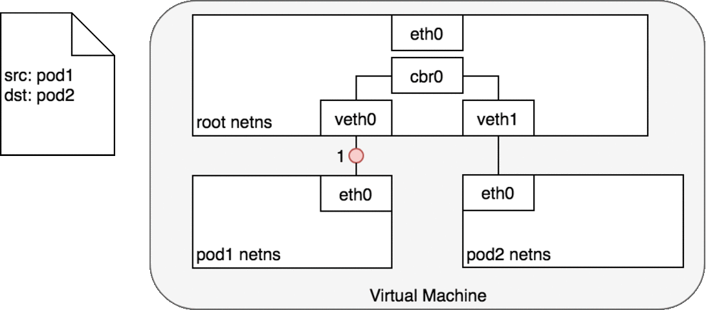

## Flow from kubectl apply -f pod.yaml to object in etcd

- Get the version from http path (e.g. v1 or v1beta1)
- Create the empty object using Scheme in the right version
- JSON or protobuf decoder converts the payload into object
- Write requests are all applied to ETCD leader node

## Flow from kubectl get pods

- Get request is sent to kube-apiserver
- kube-apiserver uses the ETCD client lib to talk to etcd cluster.
  [Implementation](https://github.com/kubernetes/apiserver/blob/master/pkg/storage/storagebackend/factory/etcd3.go#L110)
- ETCD3 client performs a quorum read by default to make sure always the latest value gets returned. ETCD2 needs to pass
  in a flag `quorum-read=true` to achieve the quorum read
## How pod is created via Deployment with the network configured

- `Deployment` controller (inside kube-controller-manager):
  - Notices (through a deployment informer) that user creates a `Deployment` object.
  - Create a `ReplicaSet` object.
- `ReplicaSet` controller (inside kube-controller-manager):
  - Notices (through a replicaSet informer) that the newly created `ReplicaSet` object.
  - Create `Pod` objects.
- `kube-scheduler` which is also a controller (inside kube-scheduler binary):
  - Notices (through a pod informer) that the `Pod` objects with empty `Pod.spec.nodename`.
  - Puts the `Pod` objects in the scheduling queue.
- The meanwhile the `kubelet` (is also a controller):
  - Notices the `Pod` objects (through a pod informer) that the `Pod.spec.nodeName` (which are empty) does not match its node name.
  - Ignores the `Pod` objects and goes back to sleep
- `kube-scheduler`:
  - Dequeues the `Pod` object from its work queue.
  - Schedules it to the node has enough resource by updating `Pod.spec.nodeName`.
  - Sends the updates to API Server.
- `kubelet` wakes up by the Pod object update events:
  - Compares the `Pod.spec.nodeName` (in this case, we assume it matches node name).
  - Talks to container runtime via `CRI` to start the containers of the `Pod` objects.
  - Updates the `Pod` objects status with the information indicates that the containers have been started.
  - Report back to API Server.
- Container runtime interacts with K8S network plugin via `CNI` to create the network for the pod:
  - Add: the `Pod` object is created, configure the network for that `Pod` object.
  - Delete: the `Pod` object is deleted, cleanup the network resource for that `Pod object.
  - Check: can be called periodically to make sure everything is good.

- `CNI` will create `veth` pair and assign IP address to that `Pod` object.

- `ReplicaSet` controller reconciles the `Pod` objects.
- If Pod object terminates unexpectedly, kubelet notices the change:
  - Get the Pod object from API Server.
  - Change its status to "Terminated".
  - Send the updates back to API Server.
- The `ReplicaSet` controller notices the terminated pod and decides that this pod must be replaced:
  - It deletes the terminated pod and creates a new one.
- And so on
